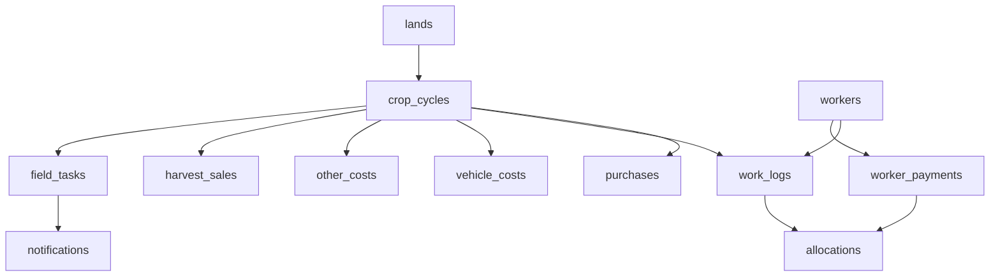

# Crop Lifecycle Tracker — Revised Plan

**Defaults:** personal/family farm, browser web app (PWA-ready), PostgreSQL 14+, money `numeric(12,2)`, quantities `numeric(12,3)`, soft delete + `created_by` / timestamps on every table.

**Schema source of truth:** [`db/schema.sql`](../db/schema.sql) (revised SQL with locked fixes applied).

---

## Verdict on the schema

Adopt the unified purchases + work/pay/allocations model.

**What is especially right**
- **`purchases` + category** — one CRUD path; UI still shows Seeds / Fertilizers / Farm materials as filtered tabs.
- **`work_logs` vs `worker_payments` vs `allocations`** — matches real farm practice (work today, pay later, advances, one lump sum covering many days).
- **Credit everywhere** (`amount_paid` / `amount_received` + generated `payment_status`) — enables **money I owe** vs **money owed to me**.
- **Lease as a single `other_costs` row** (`is_lease` + unique index) — no double-counting `lands.lease_amount`.
- **`area_planted` / `harvested_quantity`** — cost per area, yield per area, unsold stock via `cycle_stock`.
- **`units` table** — stops report fragmentation (`kg` vs `Kg`).
- **`cycle_summary` / `worker_balance` / `cycle_cost_breakdown`** — report layer belongs in SQL, not reinvented in the UI.
- Soft delete, `set_updated_at`, remind-index on `field_tasks` — solid ops habits.



---

## Naming (UI vs tables)

| Screen | Tables |
|--------|--------|
| Lands | `lands` |
| Crop cycles | `crop_cycles` |
| Seeds / Fertilizers / Farm materials | `purchases` filtered by `category` |
| Workers | `workers`, `work_logs`, `worker_payments`, `worker_payment_allocations` |
| Vehicles | `vehicles`, `vehicle_costs` |
| Other costs | `other_costs` (includes lease row) |
| Harvest sales | `harvest_sales` |
| Field tasks / Calendar | `field_tasks` |
| Reminders | `notifications`, `push_subscriptions` |

---

## Money rules (from views)

```text
total_investment = purchases + work_logs.amount_due + vehicle_costs + other_costs
                   (lease only via other_costs is_lease row)

net_gain = total_sales − total_investment

workers_due / money_i_owe / money_owed_to_me = from cycle_summary
worker balance across cycles = worker_balance view
unsold = harvested_quantity − sold_quantity (cycle_stock)
```

---

## Locked schema fixes (applied in schema.sql)

1. On “Mark as paid”, auto-create/link a `workers` row if missing (payments keep `worker_id` required).
2. `notifications.user_id` is `NOT NULL` so the unique key works.
3. App (and later triggers) must cap allocations: sum per payment ≤ payment.amount; sum per work_log ≤ amount_due.
4. Optional `paid_on` on purchases/vehicles/other skipped in v1; keep `amount_paid` only.
5. `push_subscriptions` in schema; ship in-app + browser first.
6. `created_by` / `user_id` remain plain uuid until auth provider is chosen.

---

## Screens

1. **Home** — active crop cycles with Invested / Sold / Gain from `cycle_summary`; Upcoming field tasks; bell; optional Money I owe / Owed to me.
2. **Lands** — area, owned/leased; open → crop cycles.
3. **Crop cycle detail** — gain header, Workers due; tabs for purchase categories, workers, vehicles, other costs, harvest sales, calendar.
4. **Workers** — log work (`work_logs`); pay cash (`worker_payments` + allocate to logs); badges Due / Partial / Paid; advances show on `worker_balance`.
5. **Calendar** — field tasks + dated costs/sales; schedule + remind.
6. **Cycle report** — `cycle_cost_breakdown`, `cycle_stock`, cost/yield per area.

---

## Build order

1. Apply schema and reporting views
2. Lands + Crop cycles (lease auto-row)
3. Purchases tabs + Vehicles + Other costs
4. Workers work/pay/allocate
5. Harvest sales + summary/report
6. Field calendar
7. Reminders (in-app/browser; push later)

---

## Out of scope for v1

- Multi-farm SaaS / roles beyond simple `user_id` on notifications
- Full accounting / GST exports
- Complex task recurrence
- SMS / WhatsApp
- Offline-first mobile (PWA push is the stretch goal)
